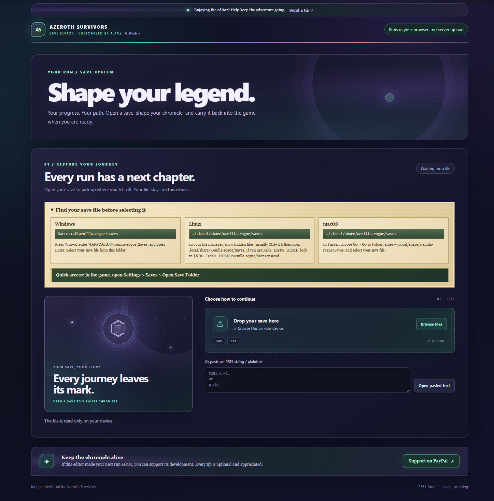
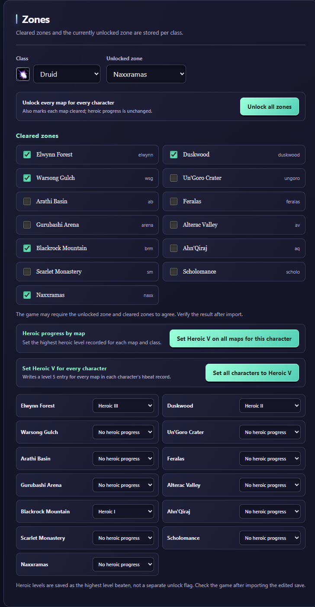
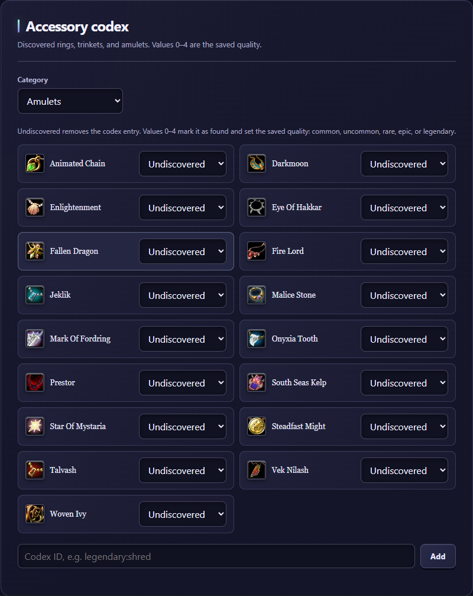
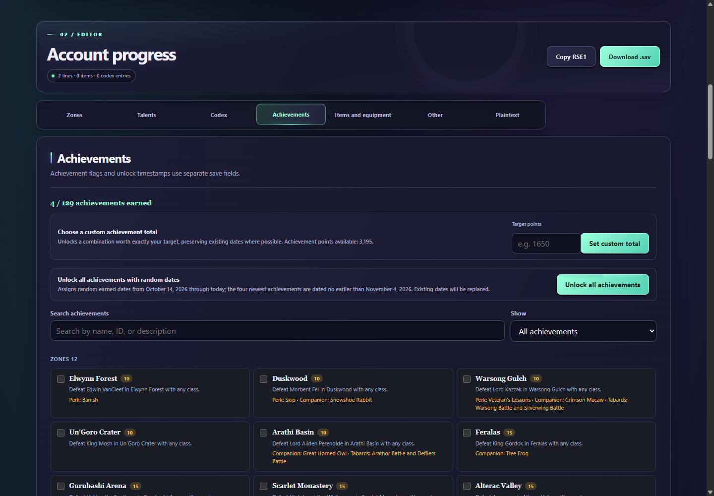
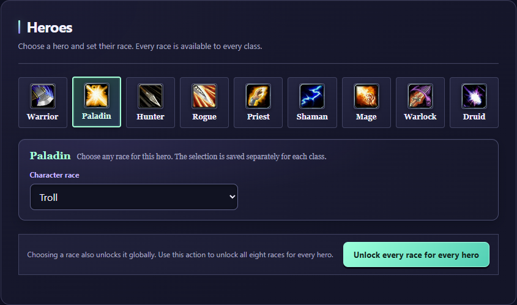
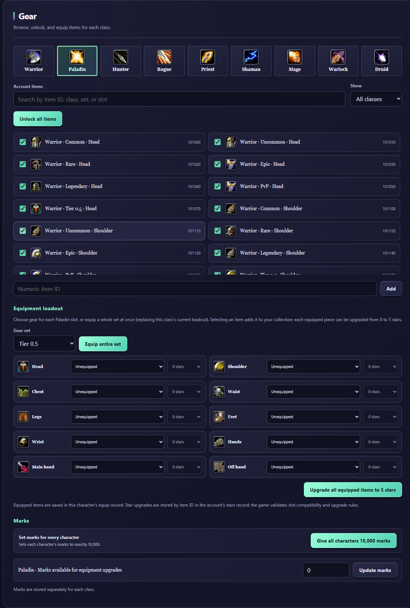
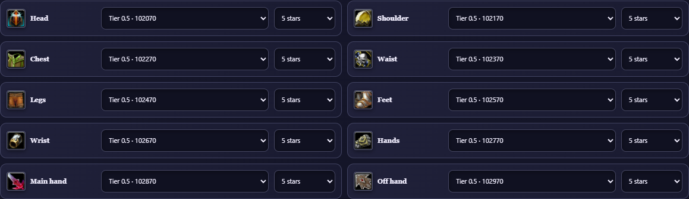
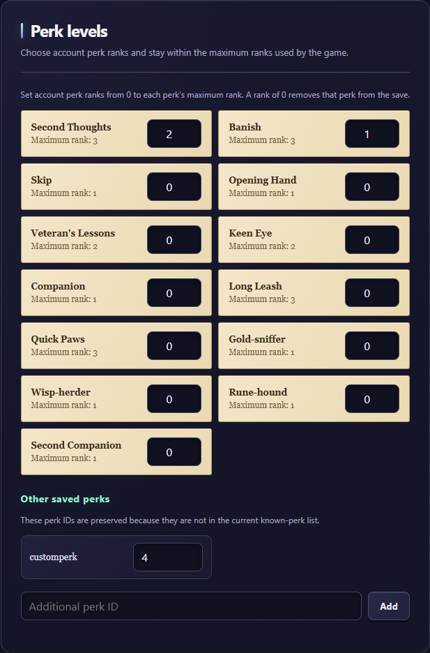
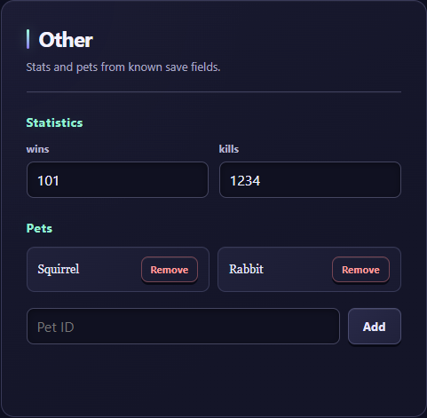
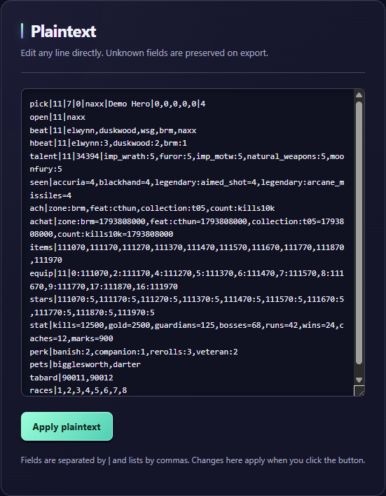

# Azeroth Survivors Save Editor — Free Online Tool by ajtvz

**Remade and maintained by ajtvz** · Created by [darhanger](https://github.com/darhanger)

## [✨ Open the editor — use it in your browser](https://ajtvz.github.io/ASeditor/)

Updated for **Azeroth Survivors v0.141.0**, this free browser-based **Azeroth Survivors save editor** lets you customize characters, gear sets, achievements, talents, and more—then export an edited `.sav` file or copy its RSE1 string. No download or installation needed; save data is processed locally in your browser, not uploaded to a server.

## Editor features

### Character progress, zones, and Heroic levels

Set a character's unlocked map, toggle cleared zones, and edit Heroic progress per map. Bulk actions can unlock all zones or set Heroic V for one or every character.

### Accessory codex

Browse amulets, legendary amulets, rings, and accessories. Mark entries undiscovered or set their saved quality from 0 to 4, and add a custom codex ID.

### Achievements

Search and filter achievements, toggle earned status and dates, unlock all achievements with generated dates, or choose an exact achievable point total. The editor enforces the configured minimum dates for newer achievements.

### Heroes, races, and talents

Choose a hero in the **Heroes** tab, select any of the eight races for that character, and edit that class's talent experience and individual talent ranks in the same place. Selecting a race unlocks it globally; a bulk action can unlock every race for every hero. The talent editor summarizes earned, spent, and available points, and supports adding talent IDs.

### Item collection, gear sets, and equipment upgrades

The **Gear** tab keeps the existing item selection controls and collection view. Browse gear by class and set, search by ID, filter collected or missing pieces, unlock a class collection or every item (including while viewing all classes), and reset to the imported collection. Equip items slot by slot **or equip an entire set at once**. Set each equipped item's upgrade level from 0 to 5 stars, or upgrade all equipped items together. Equipment marks can also be edited.

### Perk ranks

The dedicated **Perks** section lists known account perks and maximum ranks, lets you set each rank from 0 to its game maximum, and preserves custom perk IDs.

### Statistics and pets

Edit known account statistics and companion pets.

### Plaintext save editor

Inspect or edit save records directly. Unknown lines are preserved when editing through the forms; plaintext changes apply when you click **Apply plaintext**.

## How to use

1. **[Open the editor](https://ajtvz.github.io/ASeditor/).**
2. Select a save file from the game's `Saves` folder, drop a file, or paste an RSE1 string or plaintext.
3. Edit any section, then download the edited `.sav` file or copy the RSE1 string.
4. Import the edited save in the game. Keep your backup until you confirm it works.

## Find your save file

The editor runs in your browser and does not search your computer automatically. Use **Browse files** to select a save file from the game's `Saves` folder:

| Platform | Saves folder |
| --- | --- |
| Windows | `%APPDATA%\wenilla-rogue\Saves` |
| Linux | `~/.local/share/wenilla-rogue/Saves` (or `$XDG_DATA_HOME/wenilla-rogue/Saves`) |
| macOS | `~/.local/share/wenilla-rogue/Saves` |

For quick access, open the game and choose **Settings → Saves → Open Save Folder**. On Windows, you can also press **Win+R**, enter `%APPDATA%\wenilla-rogue\Saves`, and press Enter.

## Support development

Enjoying the editor? [💜 Support ajtvz on PayPal](https://paypal.me/aaronaj222). Donations are optional and appreciated.

## Important notices

- **Back up your save first.** Importing an edited save into the game replaces the current progress represented by that save. Keep the original until you have confirmed the edited save works.
- **Local processing.** The editor reads and modifies the file in your browser; it does not upload save data to the editor's server. You choose where to save or import the exported result.
- **Results are not guaranteed.** The game may reject, ignore, or recalculate edited values, including achievements and other progression. Review changes and verify them in game.
- **Independent fan-made project.** This community editor is not affiliated with, endorsed by, or an official product of the game's developers or publisher. Azeroth Survivors and related marks belong to their respective owners.

## Credits

The original Azeroth Survivors Save Editor was created by [darhanger](https://github.com/darhanger/AzerothSurvivors-SaveEditor). This edition is customized and maintained by [ajtvz](https://github.com/ajtvz), with expanded save customization and additional achievement tools.
